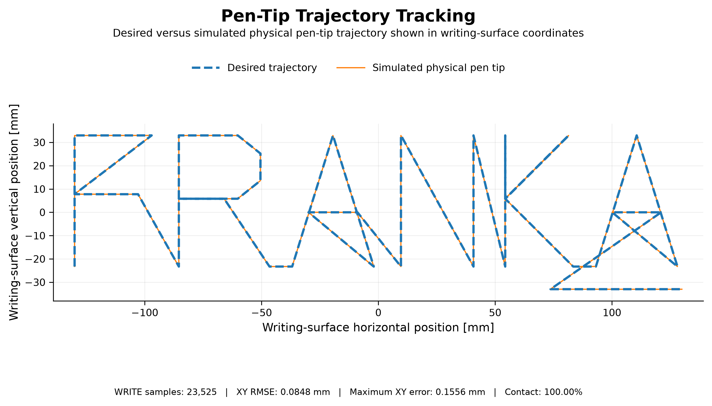
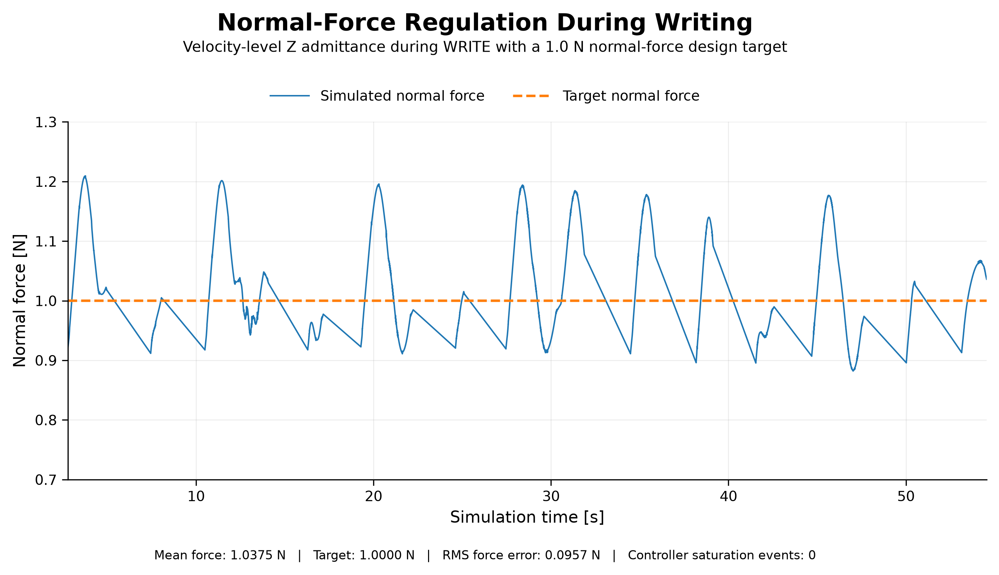
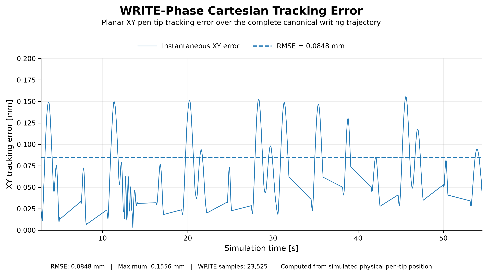
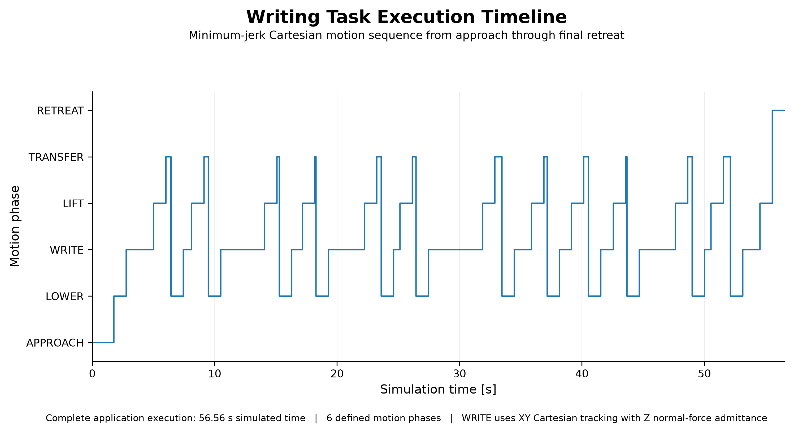

# Franka Writing Studio — Physics-Based Robotics Digital Twin

[](https://github.com/Devansh-Mishra-30/franka-writing-studio/actions/workflows/ci.yml)
[](LICENSE)
[](Dockerfile)
[](https://github.com/Devansh-Mishra-30/franka-writing-studio/releases/latest)

## Overview

Franka Writing Studio is a simulation-only robotics application for a 7-DoF Franka robot. A user can draw directly in the PySide6 dashboard or provide supported SVG geometry. Both inputs are normalized into a common `DrawingDocument`, converted into pen-tip waypoints, placed inside the modeled notebook, planned, validated, and executed in PyBullet.

During writing, the controller combines Cartesian XY path tracking, Z-axis normal-force velocity admittance, and orientation hold. Damped least-squares differential inverse kinematics maps the Cartesian command to bounded joint-velocity commands.

The v1.1 dashboard adds multi-stroke freehand input, live engineering telemetry, persistent post-run PyBullet inspection, portfolio camera controls, PyBullet video capture, and engineering-telemetry MP4 recording. The project also includes Pinocchio rigid-body dynamics, MATLAB cross-software verification, controlled synthetic model mismatch, residual learning, Docker reproducibility, automated verification, and GitHub Actions CI.

> This repository demonstrates simulation, controls, software architecture, and verification. It has not been deployed on a physical Franka and is not a safety-certified robot controller.

## At a Glance

| | |
|---|---|
| **Inputs** | Interactive freehand DRAW + supported SVG |
| **Robot** | 7-DoF Franka digital twin |
| **Control** | XY Cartesian tracking + Z force-velocity admittance + orientation hold |
| **Motion** | Minimum-jerk trajectories + damped least-squares differential IK |
| **Validation** | 181 automated tests + SVG, drawing, and dashboard E2E gates |
| **Canonical WRITE performance** | 100% simulated contact, 0.0685 mm XY RMSE |
| **Observability** | Live force, XY error, contact, phase, state, and progress telemetry |
| **Media output** | PyBullet execution video + engineering telemetry MP4 |

**Latest release:** [`v1.1.0`](docs/releases/v1.1.0.md)

## Demo

Launch the interactive command center:

```bash
./wr build
./wr ui
```

The dashboard opens in **DRAW** mode. Draw with a mouse, touchscreen, or stylus; each pointer gesture becomes a separate pen stroke. **Undo Last Stroke** and **Clear** are available before execution.

For the full visual demo:

1. Enable **Show PyBullet robot window**.
2. Keep **Run complete writing plan** enabled.
3. Keep **Keep PyBullet open after completion** enabled when you want to inspect or capture the final scene.
4. Optionally enable **Record PyBullet video** and **Record engineering telemetry**.
5. Choose **RUN LIVE**.

The **SVG** tab remains available and uses the same planning, validation, execution, and telemetry pipeline.

The PyBullet view includes Isometric, Top, Notebook, and Robot presets plus orbit, tilt, zoom, and pan controls.

Run the canonical headless SVG acceptance cycle with:

```bash
./wr e2e
```

## v1.1.0 Release Verification

The v1.1.0 release gate completed successfully:

| Gate | Result |
|---|---:|
| Automated pytest suite | 181 passed |
| Canonical SVG E2E | PASS |
| Freehand drawing E2E | 3 / 3 PASS |
| Dashboard DRAW E2E | PASS |
| Environment doctor | PASS |
| Repository audit | COMPLETE |

Latest canonical SVG acceptance run:

| Metric | Result |
|---|---:|
| WRITE samples | 24,622 |
| WRITE contact rate | 100.00% |
| WRITE XY RMSE | 0.0685 mm |
| WRITE maximum XY error | 0.1496 mm |
| Mean WRITE force | 0.9908 N |
| Target normal force | 1.0000 N |
| Force RMS error | 0.0692 N |
| Force-control saturation count | 0 |

Three independent freehand-drawing acceptance runs also completed with 100% WRITE contact. Their XY RMSE values were 0.0699 mm, 0.0946 mm, and 0.0779 mm.

These are deterministic simulation results, not physical-robot accuracy claims.

<details>
<summary><strong>Historical v1.0 validation baseline</strong></summary>

### Historical v1.0 Validated Results

Canonical release experiment:

- SVG: `svg/franka_portfolio.svg`
- Git commit: `a12ad83d0ca8784b6059cd63f59b7ac2044c00ba`
- Environment state: clean
- Simulation timestep: 1 ms
- Complete plan: home, approach, write, transfer, retract, and return

| Metric | Result |
|---|---:|
| WRITE samples | 23,525 |
| WRITE contact rate | 100.00% |
| WRITE XY RMSE | 0.0848 mm |
| WRITE maximum XY error | 0.1556 mm |
| Mean normal force | 1.0375 N |
| Target normal force | 1.0000 N |
| Force RMS error | 0.0957 N |
| Force-control saturation count | 0 |
| Simulated steps | 56,560 |
| Wall-clock execution | 22.67 s |
| Real-time factor | 2.49× |

These are deterministic simulation results, not physical-robot accuracy claims.









</details>

## System Architecture

```text
Interactive DRAW ──┐
                   ├──► DrawingDocument
SVG ─► SVG adapter ┘          │
                              ▼
                     drawing_to_waypoints
                              │
                              ▼
                 scale and place in notebook
                              │
                              ▼
                     TimedWritingPlan
            approach / write / transfer / retract
                              │
                              ▼
                      workcell validation
          bounds / reachability / sampled collision
                              │
                              ▼
                       RobotInterface
          lifecycle / commands / faults / cancellation
                              │
                              ▼
                 hybrid Cartesian controller
             XY position tracking
             Z force-velocity admittance
             orientation hold
                              │
                              ▼
                damped least-squares IK
                              │
                              ▼
                      PyBulletAdapter
             simulation / contact / telemetry
                              │
                 ┌────────────┴────────────┐
                 ▼                         ▼
          PyBullet video           telemetry video
```

Primary boundaries:

- `robot/`: commands, application state, status, faults, and public robot interface
- `tasks/`: writing-task planning, validation, execution, and cancellation
- `workcells/`: notebook, table, tools, workspace, and collision preflight
- `simulation/`: PyBullet-specific implementation
- `ui/`: PySide6 command center and experiment worker
- `verification/`: Pinocchio/MATLAB and model-mismatch workflows
- `learning/`: offline residual-model training and evaluation
- `tests/`: numerical, unit, component, and lifecycle tests

## Documentation

- [System architecture](docs/architecture.md)
- [Robot task interface](docs/robot_task_interface.md)
- [Validation and reproducibility](docs/validation.md)
- [v1.1.0 release notes](docs/releases/v1.1.0.md)
- [Changelog](CHANGELOG.md)

## Writing Pipeline

1. Acquire either freehand dashboard strokes or supported SVG path geometry.
2. Normalize the input into an ordered `DrawingDocument`.
3. Convert ordered strokes into pen-tip waypoints while preserving pen lifts between strokes.
4. Map the source geometry into the notebook work area while preserving aspect ratio and, for dashboard input, canvas whitespace.
5. Add approach, lowering, writing, transfer, lifting, retract, and return motion.
6. Create minimum-jerk Cartesian segments with `TimedWritingPlan`.
7. Validate notebook bounds, sampled reachability, and sampled robot-table collision.
8. Execute through `RobotInterface` using the existing hybrid Cartesian controller and differential IK stack.
9. Stream live engineering telemetry and write run artifacts.
10. Optionally record PyBullet and telemetry videos and retain the completed PyBullet scene for inspection.

## Kinematics and Differential IK

The official Franka URDF is pinned as a Git submodule. Pinocchio supplies forward kinematics, frame Jacobians, and rigid-body dynamics.

The motion controller uses damped least-squares differential inverse kinematics:

$$
\dot{q}=J^{T}(JJ^{T}+\lambda^{2}I)^{-1}v
$$

The implementation applies official joint-position and joint-velocity limits and holds the selected tool orientation while tracking the pen-tip reference.

## Trajectory Generation

`DrawingDocument` processing produces source waypoints from either freehand dashboard strokes or supported SVG geometry. `TimedWritingPlan` converts those waypoints into the executed trajectory. Each segment uses minimum-jerk interpolation:

$$
s(\tau)=10\tau^3-15\tau^4+6\tau^5,\qquad 0\leq\tau\leq1
$$

Segment durations are determined from Cartesian distance, configured speed, and a minimum-duration bound.

## Hybrid Position / Force Control

The accurate controller description is:

> XY Cartesian position tracking, Z normal-force velocity admittance during writing, and orientation hold, mapped through damped least-squares IK to bounded joint-velocity commands.

The force loop adjusts commanded vertical velocity using normal-force error. It is velocity-level admittance control, not torque-level impedance control.

## Rigid-Body Dynamics

Pinocchio computes forward kinematics, frame Jacobians, the joint-space mass matrix, velocity-product effects, gravity torque, and recursive Newton–Euler inverse dynamics. These quantities support verification and offline modeling experiments; the active PyBullet writing controller is velocity-command based.

## Verification and Validation

The project includes:

- Jacobian finite-difference checks
- Pinocchio–PyBullet frame agreement
- Pinocchio internal inverse-dynamics reconstruction
- Independent MATLAB Robotics System Toolbox comparison
- Workcell bounds and sampled reachability validation
- Sampled robot–table collision preflight
- Application lifecycle, STOP, fault, and RESET tests
- Quantitative end-to-end acceptance testing
- GitHub Actions CI using the Docker environment

Across 10 seeded states, maximum Pinocchio–MATLAB differences were:

| Quantity | Maximum difference |
|---|---:|
| FK position | $1.36\times10^{-16}$ m |
| FK rotation | $2.11\times10^{-8}$ rad |
| Jacobian | $1.36\times10^{-15}$ Frobenius norm |
| Mass matrix | $1.25\times10^{-15}$ Frobenius norm |
| Velocity-product torque | $8.20\times10^{-15}$ N·m |
| Gravity torque | $9.24\times10^{-15}$ N·m |
| Inverse dynamics | $9.66\times10^{-15}$ N·m |

This verifies cross-library implementation and convention agreement using the same URDF; it does not establish physical-model accuracy.

## Model Mismatch and Residual Learning

A controlled offline experiment perturbs the modeled mass and rotational inertia associated with joint 4 by 15%. A multivariate ridge model trained on 5,000 seeded states and 176 nonlinear dynamics-inspired features was evaluated on a separate writing trajectory:

| Metric | Result |
|---|---:|
| Physics-only residual RMS norm | 0.294519 N·m |
| Hybrid residual RMS norm | 0.073457 N·m |
| Reduction | 75.06% |

This is an offline synthetic mismatch-correction experiment. It is not physical system identification, deep learning, online adaptation, or a deployed controller.

## Robot Application Interface

Commands:

- `HOME`
- `START_WRITING`
- `STOP`
- `RESET`

Nominal lifecycle:

```text
INIT → HOMING → READY → PLANNING → VALIDATING → EXECUTING → COMPLETE
                                              └───────────→ STOPPED / FAULT
```

The interface provides state, task status, progress, fault information, telemetry, cooperative cancellation, and reset behavior. It is structured for future ROS 2 and PLC adapters; neither adapter is included in this release.

## Testing

```bash
./wr doctor
./wr audit
./wr test
./wr e2e
```

Current v1.1.0 release gate: **181 tests passing**.

GitHub Actions checks out the pinned submodule, builds the Docker image, and runs the pytest suite for pushes and pull requests.

## Quick Start

Requirements: Git, Docker, and WSLg or an X server for the GUI.

```bash
git clone --recurse-submodules \
  https://github.com/Devansh-Mishra-30/franka-writing-studio.git
cd franka-writing-studio

./wr build
./wr doctor
./wr test
./wr e2e
./wr ui
```

Available commands:

```text
./wr build
./wr rebuild
./wr test
./wr e2e
./wr shell
./wr ui
./wr phase4
./wr phase5
./wr phase6
./wr doctor
./wr audit
./wr clean
./wr status
```

MATLAB verification requires a compatible MATLAB installation with Robotics System Toolbox.

## Repository Structure

```text
drawing.py       Common DrawingDocument and freehand waypoint conversion
svg_adapter.py   SVG-to-DrawingDocument compatibility adapter
config/          Release configuration
docs/            Architecture, validation, releases, and curated media
experiments/     Writing experiment orchestration
learning/        Offline residual learning
robot/           Robot application interface
scripts/         Acceptance and result-generation tools
simulation/      PyBullet implementation
svg/             Release SVG inputs
tasks/           Application tasks
tests/           Automated test suite
third_party/     Pinned Franka-description submodule
tools/           Tool abstractions
ui/              PySide6 command center
urdfs/           Simulation-ready robot/tool models
verification/    Cross-software and mismatch verification
workcells/       Writing-cell model and validation
```

## Limitations

- Simulation only; no physical Franka deployment
- No ROS 2 or PLC integration in this release
- No safety PLC, certified E-stop chain, guarding, or safety validation
- No perception sensors or vision pipeline, TCP calibration, or physical work-object registration
- Pen is rigidly attached; autonomous pickup and return are not implemented
- Collision preflight is sampled and focused primarily on robot–table collision
- No general motion planner or continuous collision checking
- SVG support uses the repository's legacy path parser and is not arbitrary SVG compatibility
- Residual learning is offline and is not part of active control

## Future Work

1. Expose writing through a ROS 2 action.
2. Add HOME and RESET services and a status topic.
3. Preserve cancellation and fault semantics across ROS 2.
4. Add a simulated PLC handshake with command IDs, acknowledgements, heartbeat, `Ready/Busy/Done/Fault`, and communication-loss behavior.
5. Validate the complete ROS 2–PLC sequence with fault injection.

## License

Released under the [MIT License](LICENSE).
